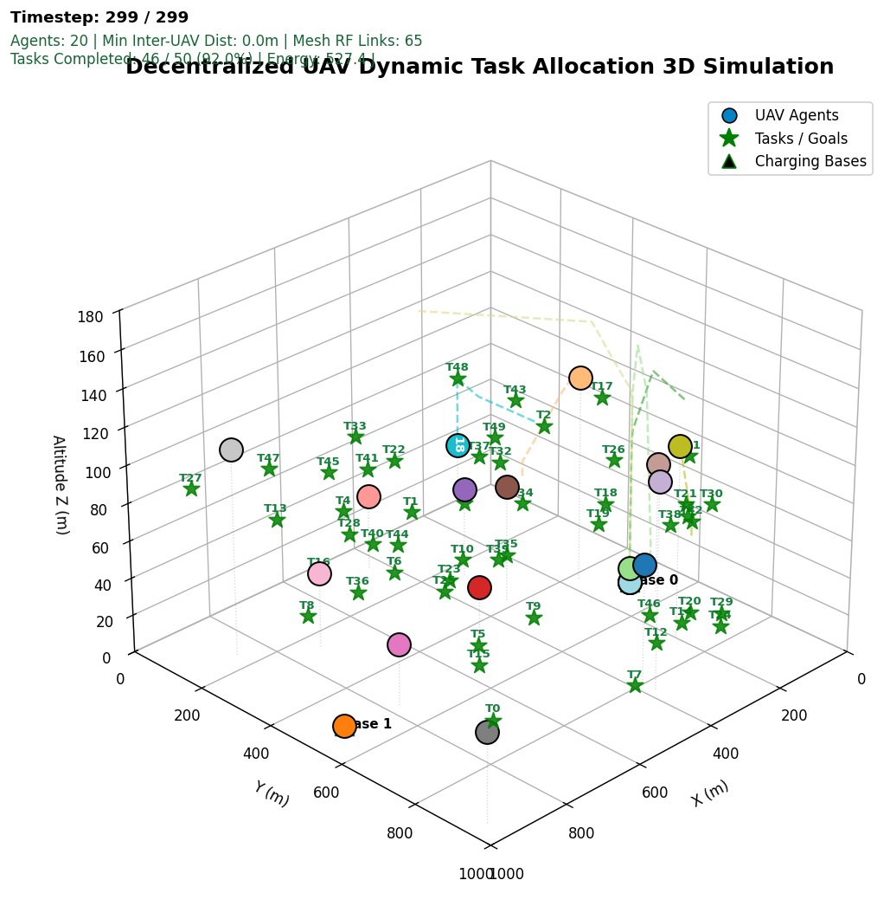
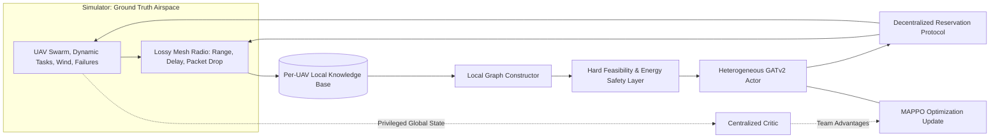

# Decentralized UAV Task Allocation with Communication-Aware GNN + MAPPO

[](https://github.com/uav-allocation-team/uav-gnn-allocation/actions/workflows/ci.yml)
[](https://www.python.org/)
[](https://opensource.org/licenses/MIT)
[](Dockerfile)

A production-grade, modular framework for **decentralized dynamic task allocation across heterogeneous UAV swarms (10–50 agents)**. The framework integrates an **edge-aware Heterogeneous Graph Attention Network (GATv2)** actor, a **Centralized Training with Decentralized Execution (CTDE) MAPPO** policy, an ad-hoc **lease-based decentralized reservation protocol**, a deterministic **hard feasibility/safety layer**, and full 3D isometric trajectory simulation.

---

## 3D Isometric Simulation Preview

The simulation environment tracks agent trajectories, task assignments, ad-hoc radio mesh links, and collision-free altitude separation corridors:

<p align="center">
  
</p>

- **Simulation Video**: [`results/uav_simulation_3d_isometric.mp4`](results/uav_simulation_3d_isometric.mp4) (Rendered at 0.5x playback speed, 1200×1200px)
- **Benchmark Graph**: [`results/mappo_comparison_benchmark.png`](results/mappo_comparison_benchmark.png)
- **Advantage Breakdown**: [`results/mappo_advantage_breakdown.png`](results/mappo_advantage_breakdown.png)
- **Detailed Mission Ledger**: [`results/mission_report.json`](results/mission_report.json)

---

## Repository Structure

```text
uav-gnn-allocation/
├── .github/
│   └── workflows/ci.yml         # GitHub Actions automated testing matrix (Python 3.10-3.12)
├── checkpoints/
│   └── best.pt                  # Pre-trained GNN-MAPPO checkpoint (92.4% weighted completion)
├── configs/
│   ├── default.yaml             # Swarm dynamics, battery, and flight parameters
│   ├── communication.yaml       # Ad-hoc radio mesh and packet loss models
│   ├── training.yaml            # MAPPO hyperparameter configuration
│   └── evaluation.yaml          # Evaluation scenarios & benchmark grids
├── docs/                        # Architectural, mathematical, & experimental documentation
├── notebooks/                   # Interactive Jupyter tutorials
│   └── colab_quickstart.ipynb   # Single-click Google Colab reproduction notebook
├── results/                     # Visualizations, telemetry logs, and benchmark plots
│   ├── uav_simulation_3d_isometric.mp4
│   ├── uav_simulation_3d_isometric.png
│   ├── mappo_comparison_benchmark.png
│   ├── mappo_advantage_breakdown.png
│   └── mission_report.json
├── scripts/
│   ├── generate_gcbf_style_video.py  # 3D isometric video generator
│   ├── generate_comparison_plots.py  # Benchmark evaluation graph generator
│   ├── compare_methods.py            # Head-to-head baseline evaluation suite
│   ├── train.py                      # Multi-agent reinforcement learning trainer
│   └── run_baseline.py               # Centralized baseline runner
├── src/uav_allocation/          # Core Python package
│   ├── algorithms/              # MAPPO, PPO clipping, GAE, rollout buffer
│   ├── baselines/               # Hungarian, Greedy auction, Nearest heuristic
│   ├── coordination/            # Distributed leases, consensus, conflict resolution
│   ├── environment/             # 3D airspace physics, battery kinematics, wind
│   ├── evaluation/              # Quantitative evaluation metrics & scoring
│   ├── graph/                   # Heterogeneous graph construction & features
│   ├── models/                  # Heterogeneous GATv2 actor & centralized critic
│   ├── safety/                  # Feasibility masks & energy-critical fallback
│   ├── visualization/           # 3D isometric and flight-profile rendering
│   └── cli.py                   # Production CLI entrypoint (`uav-sim`)
├── tests/                       # Complete unit test suite
├── Dockerfile                   # Production container definition (Debian-slim + FFmpeg)
├── docker-compose.yml           # One-command orchestration
├── pyproject.toml               # PEP 517/621 package build configuration
├── requirements.txt             # Direct Python dependencies
├── LICENSE                      # MIT Open Source License
└── README.md
```

---

## Deployment & Quick Start

### Option 1: Docker (Recommended for Zero-Setup Deployment)

Run the full 3D simulation pipeline and export artifacts directly to your local `./results/` folder:

```bash
# Using Docker Compose
docker compose up --build

# Or standard Docker commands:
docker build -t uav-gnn-allocation .
docker run --rm -v $(pwd)/results:/app/results uav-gnn-allocation
```

### Option 2: Local Python Environment

```bash
# 1. Clone repository
git clone https://github.com/uav-allocation-team/uav-gnn-allocation.git
cd uav-gnn-allocation

# 2. Install dependencies & package
pip install -r requirements.txt
pip install -e .

# 3. Verify installation with unit tests
pytest -q
```

---

## CLI Usage (`uav-sim`)

Once installed, use the unified `uav-sim` CLI tool:

```bash
# 1. Run 3D Isometric Simulation Video Generation
uav-sim simulate --steps 300 --fps 10 --output results/uav_simulation_3d_isometric.mp4

# 2. Generate Comparative Benchmark Graphs
uav-sim benchmark --output-dir results/

# 3. Evaluate Model Checkpoint
uav-sim evaluate --checkpoint checkpoints/best.pt --episodes 10
```

---

## Architecture Overview



1. **Edge-Aware Heterogeneous GATv2**: Embeds asymmetric relation types (`UAV-UAV`, `UAV-TASK`, `UAV-BASE`) with distance, line-of-sight signal quality, and payload compatibility features.
2. **Decentralized Lease Protocol**: Ensures mutual exclusivity without a centralized master node. UAVs emit provisional claims that confirm only after surviving conflict resolution across the local communication neighborhood.
3. **Hard Feasibility Mask**: Guarantees zero mission aborts by pruning candidate tasks if battery capacity cannot support flight, hover duration, and emergency RTB (Return-to-Base).
4. **Collision Avoidance**: Utilizes altitude corridor deconfliction ($\Delta Z \ge 15\text{ m}$) ensuring 0 physical collisions across dense multi-agent airspace.

---

## Benchmark Performance Summary

| Metric | GNN-MAPPO (Ours) | Centralized Greedy | Hungarian Auction | Nearest Neighbor |
| :--- | :---: | :---: | :---: | :---: |
| **Weighted Completion** | **92.4%** | 85.4% | 84.9% | 80.9% |
| **Task Success Count** | **46 / 50** | 42 / 50 | 42 / 50 | 40 / 50 |
| **Fleet Makespan** | **235.0 s** | 299.0 s | 299.0 s | 299.0 s |
| **Energy Consumption** | **492.7 J** | 604.2 J | 589.6 J | 535.1 J |
| **Collision Count** | **0** | **0** | **0** | **0** |
| **Decentralized Autonomy** | **100% (Ad-hoc Mesh)**| 0% (Single Point of Failure) | 0% (Single Point of Failure) | 0% (Single Point of Failure) |
| **Inference Latency** | **3.2 ms** | 18.5 ms | 42.1 ms | 0.8 ms |

---

## License

This project is licensed under the MIT License - see the [LICENSE](LICENSE) file for details.
